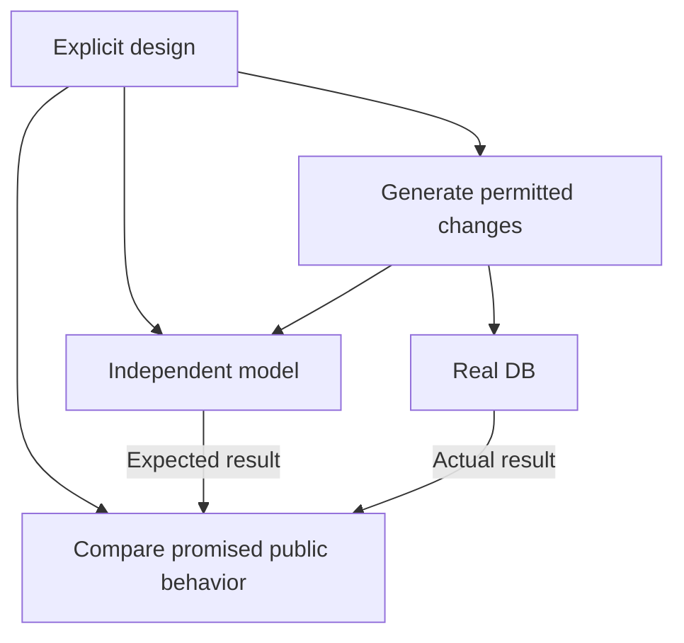

# TanStack DB 1.0 RC1: Going All In on Oracles


TanStack DB 1.0 RC1 is here! I'm delighted to announce it on behalf of the core DB maintainers—myself, Sam Willis, and Kevin De Porre—and the entire TanStack community.

After eighteen months of development, beta testing, and user feedback, the API is powerful, production-ready, and stable.

If you haven't used it yet, TanStack DB is a reactive client data framework that makes backend data feel local. Records from your API or sync engine become typed collections. Components query them for joined, filtered live results. Optimistic edits appear immediately and reconcile with the server later.

If you're upgrading an existing app, see the [1.0 RC migration guide](https://tanstack.com/db/latest/docs/guides/migrate-to-1-0-rc) for package updates and breaking API changes.

Since our [0.6 release](https://tanstack.com/blog/tanstack-db-0.6-app-ready-with-persistence-and-includes), we’ve shipped [server rendering and deep integration with TanStack Start](https://tanstack.com/db/latest/docs/guides/ssr). We’ve also added collection adapters for [Neon Realtime](https://neon.com/docs/realtime/overview) and [Convex](https://github.com/TanStack/db/pull/2230), and expanded framework support to include [Preact](https://github.com/TanStack/db/pull/2235), our sixth framework adapter. We’ve fixed an enormous number of bugs while hardening DB for 1.0—and made it much faster and smaller along the way.

DB is built for demanding applications, and making its ambitious API fully production-ready has been my main focus over the past few months.

You can adopt DB’s capabilities incrementally. Historically, getting reactive queries, optimistic mutations, and offline support often meant adopting a new database and sync architecture. With TanStack DB, you can start with your existing REST APIs and [TanStack Query](https://tanstack.com/query/latest) setup, immediately gain fast incremental relational queries, and progressively add [local persistence](https://tanstack.com/db/latest/docs/guides/sqlite-persistence), [durable offline mutations](https://tanstack.com/db/latest/docs/guides/offline-transactions), or real-time sync as needed. Because the application-facing query model stays the same, you can go from a conventional web application to a fully offline-capable, local-first app without rewriting everything along the way.

We began building DB in early 2025 at [ElectricSQL](https://electric-sql.com/), which incubated the project for its first year and a half. [Neon acquired us in August](https://neon.com/blog/electrifying-neon-building-the-realtime-backend) and has continued to back DB. We recently released [Neon Realtime](https://neon.com/docs/realtime/overview) with [TanStack DB support](https://neon.com/docs/realtime/sdks/typescript#tanstack-db).

Adoption is accelerating, with teams using TanStack DB to build everything from developer tools to consumer mobile apps. Prisma uses DB in [Prisma Studio](https://github.com/prisma/studio), its open-source database editor. Unkey uses it extensively across its [developer dashboard](https://github.com/unkeyed/unkey/tree/main/web/apps/dashboard), and Skylight uses DB and its offline capabilities in its [React Native family calendar app](https://www.youtube.com/watch?v=HSUKoa4JoRw).

The core `@tanstack/db` package now gets [over a million weekly npm downloads](https://www.npmjs.com/package/@tanstack/db). DB adoption has grown roughly 10× over the past year, using [weekly core-package downloads relative to React’s](https://tanstack.com/stats/npm?packageGroups=%5B%7B%22packages%22%3A%5B%7B%22name%22%3A%22%40tanstack%2Fdb%22%7D%5D%7D%2C%7B%22packages%22%3A%5B%7B%22name%22%3A%22react%22%2C%22hidden%22%3Atrue%7D%5D%2C%22color%22%3A%22%2361DAFB%22%2C%22baseline%22%3Atrue%2C%22baselineLabel%22%3A%22React%22%7D%5D&range=1825-days&transform=none&binType=weekly&viewMode=history&chartType=line&barSort=value&bucketOffset=0&playbackIntervalMs=350&playbackLoop=false&playbackPlaying=false&showDataMode=all&normalizeBaseline=true&showBaseline=false&showLegend=false&height=400) as a proxy. The core package now gets about 0.6% as many weekly downloads as React.

After server rendering landed a few months ago, I thought the path to 1.0 was clear: fix the known bugs. Set my agents loose, work through the list, ship in a few weeks. But I was also experimenting with ways to make those agents more effective. The new environment proved astonishingly effective at finding bugs and undefined behavior I hadn’t known to look for.

My short bug-fixing expedition has now stretched to hundreds of PRs and months of intense work hardening DB's core abstractions for 1.0.

For years, I struggled to find library bugs before users reported them. Now essentially every new agent session stumbles on multiple new classes of bugs. Many of these bugs are now so obscure that I suspect no one has encountered them in the wild. Yet they keep coming. Increasingly, my job is to keep agents from fixing _too much_—chasing hypothetical edge cases or adding complexity to solve problems DB didn't intend to solve.

Here’s how we’ve been hardening DB for 1.0, and what that work has taught me about programming with agents:

1. [From unit tests to oracles](#from-unit-tests-to-oracles): what oracles are and why I'm so excited about them
2. [Hardening DB for 1.0](#hardening-db-for-10): how we're finding bugs and making DB epically production-ready
3. [Crafting a playable environment for agents](#crafting-a-playable-environment-for-agents): how DB's design knowledge helps agents make better decisions
4. [A recipe for designing an oracle](#a-recipe-for-designing-an-oracle): how to build an oracle and connect it to formal verification
5. [Look for cranes](#look-for-cranes): why the tools around coding agents make them more effective
6. [Superhistory](#superhistory): how agents change programming's pace and economics while accelerating software maturity
7. [The world DB creates for your agents](#the-world-db-creates-for-your-agents): how frameworks can guide agents toward better application code

## From unit tests to oracles

In software testing, a [test oracle](https://en.wikipedia.org/wiki/Test_oracle) tells you what the correct behavior should be. It might be a reference model or another trusted system.

For DB, I use independent models as test oracles. They make DB’s design executable: the models calculate the answers we would otherwise have to supply by hand. Let’s walk through turning an ordinary unit test into a model-based oracle and see what we gain along the way.

A conventional unit test records the expected result for a particular example: give a sorting function `[3, 1, 2]` and verify that it returns `[1, 2, 3]`. I choose the input and supply the answer.

Let’s generalize from individual examples to rules with **property-based testing (PBT)**. A sorting function should return exactly the original elements in ascending order. A generator produces thousands of inputs—empty lists, repeated values, negative numbers, long lists—and the test verifies that rule for each one.

The generator supplies examples, but I still have to supply the rules. For a library like DB, that means spelling out which actions are allowed, how they change the data, and what its users should observe. Building a useful generated test becomes a way of working out and expressing the subsystem’s design.

Consider this live query over a collection of tasks:

```ts
const topTasks = createLiveQueryCollection((q) =>
  q
    .from({ task: tasks })
    .where(({ task }) => eq(task.completed, false))
    .orderBy(({ task }) => task.priority, 'desc')
    .orderBy(({ task }) => task.id, 'asc')
    .limit(10),
)
```

The query selects up to ten open tasks, ordered by descending priority, with ties broken by ascending ID. DB must maintain the result defined by those clauses as the source records change. Completing a selected task removes it and brings the next eligible task into the result. Raising another task’s priority can move it into the result and displace one already there. Once DB has processed a batch of changes, the published rows and their order must match that query.

We can express parts of that promise as PBT rules: no completed tasks, correct ordering, at most ten rows. But an empty result would satisfy all three. The full rule is stronger: **the result must contain exactly the tasks selected by the query, in the right order, after every batch of changes.**

A small model makes that rule executable. It keeps the task records in a plain JavaScript `Map`, applies the requested changes, then filters out completed tasks, sorts by priority and ID, and takes the first ten. Instead of supplying an expected answer for each example, I’ve written down how to calculate the answer for any example. That independent model is our **oracle**.

DB uses complex machinery to maintain the results efficiently. The model recomputes everything from scratch. It trades efficiency for simplicity, making the expected behavior straightforward to understand and inspect.

With the model supplying the expected answers, property-based testing can check the full rule across generated histories: **DB’s result must match the model’s answer.** The generator varies the starting records and sequences of supported inserts, updates, and deletes, applied individually or in batches. The test gives the same changes to the model and DB, then compares the live query’s public rows and their order with the model’s answer after each batch.



An existing system can also serve as an oracle. For server-to-client synchronization, Postgres can supply the reference: make changes in Postgres, let them synchronize, and require the client’s corresponding rows and values to match Postgres exactly. We can build on existing abstractions instead of writing every reference computation ourselves.

With an independent reference for what DB should do, agents can experiment with how to do it efficiently. They can replace the query algorithm, introduce an index, or delete a pile of bookkeeping while the oracle verifies that the promised behavior survives.

Each bug fix should strengthen that reference too. We encode the design rule the bug exposed, then explore the whole category of cases that rule governs. **An isolated test preserves an answer. An oracle preserves the understanding that produces the answers.** I no longer want agents stopping at a passing reproduction.

Oracles have massively increased the rigor of our tests. We’re gradually replacing all remaining standalone example-based tests, and we’ll soon lint against adding new ones.


## Hardening DB for 1.0

A mature library has answers to questions its authors didn’t initially know to ask. Users combine features in unexpected ways; maintainers fix the bugs and resolve the ambiguities those combinations expose. Years of that work turn a promising API into something applications can depend on.

The task query above shows why DB’s maturation is particularly demanding. If the next eligible task isn’t loaded locally, completing a selected task can require fetching it from the server. Now make that edit offline, preserve it across an app restart, and reconnect after the server’s data has changed. What should the screen show along the way? What must DB retain, fetch, and reconcile?

Oracles let me explore that design space dramatically faster, without waiting for users to discover each failure. A bug report about collection updates shows how this work builds on itself: each investigation strengthened the oracles and exposed another gap.

### How the oracles got stronger

Collections notify subscribers—such as a UI component displaying the collection’s rows—about changes with insert, update, and delete messages. A user [reported a bug](https://github.com/TanStack/db/issues/1901) where they deleted a row and inserted a replacement under the same key in the same event-loop turn. DB sent the subscriber a delete for the row but no later insert message to put it back. A direct read returned the replacement, but replaying the collection messages left the subscriber's cache without the reinserted row.

The [fix](https://github.com/TanStack/db/pull/1902) also added an oracle for the broader promise: **a subscriber applying every change message should end up with the same rows as a direct read.**

The oracle has three parts: a small reference model, a real DB collection, and a subscriber listening to that collection. The model applies the requested writes to a plain JavaScript `Map`, calculating which rows should exist. DB receives the same writes. The subscriber maintains its own map, updated only through the insert, update, and delete messages DB sends it. This lets us verify both that DB stores the right rows and that its messages give subscribers enough information to reconstruct them.

The oracle constructs histories of writes, exploring that promise from several directions:

- Start empty, with one row already present, or with two rows present.
- Insert, update, delete, and reinsert the same key; interleave writes to different keys. Give each inserted or updated row a distinct value so stale data is visible.
- Issue writes back-to-back before waiting for them to finish, or let each write finish before starting the next.
- Enumerate every legal short sequence across different starting states.
- Generate longer histories across multiple keys, with a fixed seed for repeatable coverage and fresh random seeds for further exploration.

After each completed write or group of writes, the oracle compares the model’s expected rows, a direct read from DB, and the subscriber’s reconstructed rows. All three should agree. Whenever DB delivers a batch of messages, the oracle also verifies that applying those messages leaves the subscriber with the same rows DB currently exposes. In the original failure, the model and DB held the replacement row, but DB’s messages left the subscriber’s map empty.

Later, an agent challenged the oracle by deliberately changing how DB chose between insert and update messages. The oracle accepted both versions, even though they sent different messages for the same history. Investigating why the two versions sent different messages revealed a bug in production—and a blind spot in the oracle. After a subscriber had removed a deleted row, a sync commit made the same key visible again. DB remembered the earlier optimistic operation and sent an **update**. But the subscriber no longer had that row. It needed an **insert**.

The oracle hid the mistake. Its simulated subscriber used JavaScript’s `Map.set` for both inserts and updates, so the invalid update recreated the missing row. The expected rows, direct reads, and subscriber’s reconstructed rows all agreed. I made the oracle enforce what each message means: **insert requires an absent key; update and delete require a present key.** Without adding any histories, 26 of the existing 378 cases failed. [PR #1995](https://github.com/TanStack/db/pull/1995) removed the branch that chose an update for a previously absent key. The code became smaller, and all 378 cases passed.

Another gap surfaced during a review of [PR #2004](https://github.com/TanStack/db/pull/2004). While a local optimistic edit was active, a server refresh replaced the collection’s source rows. DB sent **delete → insert → insert** for the same key. DB restored the row with its pending optimistic edit and queued an insert message, then ran its duplicate-removal step. Processing the server’s replacement rows queued another insert for the same row, after the duplicate-removal step had already run.

The histories and checks needed to catch this bug lived in different oracles. One explored server refreshes during optimistic edits, but its subscriber requested both initial rows and later changes. In that mode, DB tracks delivered rows and filters repeated inserts, hiding the duplicate. The earlier change-message oracle enforced strict message rules, but never exercised server refreshes.

In [PR #2005](https://github.com/TanStack/db/pull/2005), I extended the oracle for server refreshes during optimistic edits with a subscriber receiving only future changes, without that filtering. Because it received no initial rows, I initialized its map from the independent model. I then verified every incoming message and compared its reconstructed rows with the model after each history step. The old implementation failed seven cases. The production fix stopped generating the duplicate insert; the filtering remained unchanged.

A later random run found another duplicate insert, this time without a server refresh. Cleanup of an earlier delete sent an insert for a row the subscriber already held. The same message rule caught a different route to the failure.

The same iterative design process is happening across DB’s oracles: finding production bugs, closing gaps in coverage, discovering missing laws, and correcting mistaken assumptions in the models themselves. Each oracle develops a more precise account of its small part of DB. The design and the instruments for verifying it mature together, with each discovery preserved for every later change.

## Crafting a playable environment for agents

An agent reading DB's implementation can see what it does today. To make good changes, it needs to understand which behaviors are promises, which are accidents, and where we still need to decide what DB should do.

Building these oracles is turning DB’s repository into a “playable” environment where fresh agents can find those design decisions, experiment, and get clear feedback. Each oracle records and checks a small part of DB’s intended behavior, with the reasoning behind its rules written beside the model.

DB now has **211 oracle test files across 15 packages**, covering things like [the messages sent when data changes](https://github.com/TanStack/db/blob/main/packages/db/tests/change-event-history-oracle.test.ts), [how queries assemble related records](https://github.com/TanStack/db/blob/main/packages/db/tests/query/includes-cross-formulation-oracle.property.test.ts), and [which rows pagination returns](https://github.com/TanStack/db/blob/main/packages/query-db-collection/tests/cursor-pagination.oracle.test.ts). The repository's [coverage map](https://github.com/TanStack/db/blob/main/docs/contributing/oracle-coverage.md) helps agents find the relevant oracle.

When a change fails an oracle, the failure directs the agent to a concrete counterexample, the relevant model, and the reasoning behind its rules. The agent can investigate the disagreement before deciding what to change. Hours of earlier design work become available when needed, without requiring every fresh agent to absorb the entire design upfront.

Design that can talk back.

## A recipe for designing an oracle

Here's how I build one with my agents:

1. **Choose one precise promise.** State what someone using the software should observe, and when. This is the oracle's law. Resolve ambiguous cases explicitly: the task query above breaks ties between equal-priority tasks by ID. Record why you chose the rule and what assumptions it depends on, so later agents can recognize when the decision needs revisiting.

2. **Calculate the answer independently.** Derive it from the promise. Reusing production's algorithms or helpers can reproduce the same mistake on both sides and leave the oracle happily agreeing with broken code.

3. **Choose where and when to observe production.** Compare the behavior at the moment the promise applies. For the collection oracle, that meant observing raw messages as subscribers received them, alongside the final rows.

4. **Generate meaningful sequences.** Vary the data, operation order, and relevant timing. Tools such as [fast-check](https://fast-check.dev/) generate varied histories and shrink failures into short counterexamples that are practical to investigate.

5. **Try to fool the oracle.** Deliberately break a rule in the implementation and verify that the oracle rejects it for the intended reason. Ask a hostile reviewer—an agent tasked with finding holes—which wrong designs could still pass.

6. **Diagnose disagreements before changing expectations.** The implementation might violate the promise, the model might misstate it, or the promise itself might need redesign. Work out which needs to change. Keep the shortened failing sequence as a regression case beside the model.

I've written and heavily iterated on [oracle-authoring](https://github.com/TanStack/db/blob/main/.agents/skills/oracle-authoring/SKILL.md) and [oracle-review](https://github.com/TanStack/db/blob/main/.agents/skills/oracle-review/SKILL.md) SKILLs, plus a rigorous [14-part rubric](https://github.com/TanStack/db/blob/main/docs/contributing/oracle-rubric.md) that agents use to evaluate and improve their oracles.

### How this relates to formal verification

The oracle’s model is an **executable specification**. For difficult designs, I often develop that specification first in [TLA+](https://lamport.org/tla/tla.html), a language used in formal verification. A TLA+ model checker can explore every allowed ordering of operations within a bounded model. Can an obsolete request overwrite a newer result? Can releasing one subscription cancel work another still needs? Can a sequence of valid operations leave the system stuck? A counterexample gives me the exact sequence where a proposed rule fails, so I can investigate what needs to change in the design.

I then translate the model into a TypeScript oracle that runs against DB. TLA+ tests whether the modeled design preserves its stated rules; the oracle tests whether the actual implementation follows that design across generated histories.

## Look for cranes

The oracles I’ve described are examples of what Daniel Dennett calls **cranes**: mechanisms that make more of a design space reachable.

In [_Darwin's Dangerous Idea_](https://www.simonandschuster.com/books/Darwins-Dangerous-Idea/Daniel-C-Dennett/9780684824710), Daniel Dennett chronicles Darwin's startling claim that natural selection, with no foresight, could produce eyes, brains, and other astonishingly intricate adaptations. Many people doubted that a blind process could do this and looked for an outside intelligence to supply the design. Dennett calls that explanatory move a **skyhook**: it lowers the finished complexity into place from above like the _deus ex machina_ of Greek theater, where stage machinery lowers a god to resolve the plot.

Dennett contrasts this with **cranes**—construction cranes. Both skyhooks and cranes lift, but a crane works from existing designs. It helps you reach upwards to build a new layer. Once that layer is built, it can support new cranes that reach higher and build further layers. In evolution, cranes make more possibilities accessible to variation and selection. Sexual reproduction, for example, recombines inherited variants, letting selection work on combinations that mutation in a single lineage would reach much more slowly.


The skyhook story in agentic programming is that a sufficiently intelligent model, given a repository, will infer every unstated rule and deliver the right system in one leap. One-shot coding makes that easy to believe for familiar tasks. Those successes stand on compilers, libraries, conventions, and a vast history of solved problems in the model's training. Much of the design work has already been done.

Every substantial software project runs into questions that software history hasn't settled. Features interact in unexpected ways; new uses reveal missing guarantees. More intelligence cannot reconstruct a decision we haven't made. The work is to search the design space, decide what should hold, and test candidate answers.

**Oracles are cranes for my agents.** They make ambitious changes practical: an agent can replace complicated machinery while an independent model verifies the behavior it must preserve. Generators extend that reach by exploring combinations the agent hasn’t thought to try. Hostile reviews strengthen the oracles themselves, and benchmarks help select implementations that improve performance. These are the mechanisms I’ve been accumulating around my coding agents to make their search through DB’s design space more productive.

I also shape the _fitness landscape_—the constraints and feedback that favor some implementations over others—by editing [AGENTS.md](https://github.com/TanStack/db/blob/main/AGENTS.md). For example, I tell agents to prefer fixes that remove production code.

The oracles give that progress a ratchet. Once a design decision is captured and enforced by an oracle, it stays locked in until we deliberately revise the specification. The regressions I still find expose assumptions the oracles weren’t testing. Agents can radically rework the implementation without losing the design knowledge we’ve already established.

The work has taken three months and many billions of tokens. These changes in their working environment have mattered far more than any model upgrade I've seen.

## Superhistory

Coding agents equipped with those instruments can compress what used to be weeks of work into an afternoon. Venkatesh Rao describes AI as [“artificial time”](https://contraptions.venkateshrao.com/p/superhistory-not-superintelligence): machines accumulate and digest experience that we can draw on in our own work. I spend much of the day in what feels like a succession of intense design meetings, with fresh evidence arriving 100x faster than I could have gathered it myself.

I’m speedrunning DB through the software maturation process. Oracles let agents explore huge stretches of design space, uncovering failures and unresolved design questions that would normally emerge over years of use. Interactions between synchronization, optimistic edits, persistence, and queries get investigated long before a user happens upon that particular combination.

Programming has become more intellectually demanding for me even as writing the code has become cheaper. There are more results to interpret, more assumptions to question, and more design decisions to make.

When an idea would take weeks to investigate, I need a strong reason to try it. With agents and an oracle, I can afford to take a much less certain idea far enough to find out whether it works. That changes which designs I can explore.

Rigorous verification is much cheaper too. Test oracles have always worked incredibly well, but they're demanding to write and very verbose. In the months spent preparing DB for 1.0, the repository has gained roughly 420,000 lines of tests—probably more code than I wrote in my entire life before AI. Agents make that work practical.

## The world DB creates for your agents

Applications inherit the results of that work. DB lets you query backend data and edit it as though it were local, while handling the coordination problems we’ve been working through.

Frameworks, infrastructure, and developer tools can also use their design knowledge to guide how agents write applications. [SKILLs](https://agentskills.io/home) are a first step: DB can explain its abstractions and guarantees to an agent as it works. I think we can go a lot further and give your agents executable models and instruments they can use to develop and verify their designs.

An agent building a custom collection could use a DB oracle to discover where its sync behavior breaks down. An agent making a screen faster could experiment with loading strategies, measuring query latency and data transferred while verifying that the results stay correct.

### From server functions to live collections

These instruments also make more ambitious abstractions practical to pursue inside DB. I’m exploring an API where you write ordinary server functions to query and mutate Postgres. DB would compile them into client collections and actions, plus the server code needed to coordinate them.

_Simplified sketch of an experimental API._

```tsx
// Server: define a query
const todos = query({
  async handler(req, res) {
    return res.json(await db.select().from(todo))
  },
})

// Server: define a mutation
const addTodo = mutation({
  async handler(req, res) {
    return res.json(await db.insert(todo).values(req.body).returning())
  },
})

// Client: use the generated collection and action
const { data } = useLiveQuery(todos)
addTodo({ id: crypto.randomUUID(), text: 'Hello world' })
```

The generated code would keep active query collections current after a mutation. When a mutation runs, the client tells the server which query collections it is currently using. The server determines which need updating and returns fresh results with the mutation response.

Making this work across a wide range of Postgres queries means understanding enough of the language to preserve query meaning, determine which reads a write affects, and reconcile client state correctly. A few years ago, I wouldn't have considered attempting this hugely ambitious API. Now it feels within reach.

### Software that gets better at getting better

There’s a name for what these cranes improve: _evolvability_, a system’s capacity to support further useful development. Autonomy asks how much work an agent can do without me. Evolvability asks what new work becomes possible because of what we've learned. An agent arriving tomorrow can attempt something more ambitious using the same LLM because it inherits better cranes.

That's what makes me excited about where programming is going: the possibility of much more robust, delightful, and varied software, including ideas that used to cost too much to pursue.

[Try out our 1.0 RC](https://tanstack.com/db/latest/docs/quick-start) in a demanding application and let us know how it goes.
